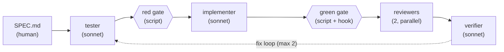

# ticket-to-merge

A Claude Code plugin that takes one ticket from spec to merge-ready: agents write the tests first, a second agent implements, read-only reviewers audit the diff, and scripts (not opinions) decide pass or fail.

Capstone for Agentic Engineering, Wave 3. Ticket: **BOOK-101 · Search books by title or author**.

- **Repo and branch:** `github.com/AAlvAAro/agent_bookshelf`, branch `feat/book-101-search`
- **Spec and conventions:** [`SPEC.md`](../SPEC.md), [`CLAUDE.md`](../CLAUDE.md) (33 lines)

## How to run

```bash
npm install
claude plugin validate ./ticket-to-merge        # passes (one warning: no icon)
claude --plugin-dir ./ticket-to-merge
```

Inside Claude Code:

| Command | What it does |
|---|---|
| `/ticket-to-merge:ship-ticket BOOK-101` | Builds the ticket in `SPEC.md` test-first, reviews it, runs the fix loop, prints a cost table. Needs a clean tree on a feature branch. |
| `/ticket-to-merge:review-pr [base]` | Reviews the current branch against its merge-base with `main` (or the base you pass). Prints one JSON block of findings: `file, line, severity, issue, evidence, reviewer`. Edits nothing. |

`review-pr` works on a branch it has never seen. If the branch has no `SPEC.md`, it uses the ticket as issued, bundled in `tickets/BOOK-101.md`.

Other checks:

```bash
npm run test:run                                         # the app's suite
node --test ticket-to-merge/hooks/test/                  # guardrail bypass suite
node ticket-to-merge/scripts/mutate.mjs                  # mutation check (no tokens, ~20s)
node ticket-to-merge/evals/run-review-evals.mjs --runs 3 # planted-bug eval (spends tokens)
```

## The pipeline



| Agent | Tools | Model | Job |
|---|---|---|---|
| `tester` | Read, Grep, Glob, Write, Edit, Bash | sonnet | One failing test per acceptance criterion, named `AC<n> ...`. Can't write `src/`. |
| `implementer` | Read, Grep, Glob, Write, Edit, Bash | sonnet | Smallest change that makes the tests pass. Can't write `tests/`. |
| `review-security` | Read, Grep, Glob | sonnet | Injection, validation that is missing or skippable, unsafe output, secrets, then an OWASP Top 10 sweep. |
| `review-correctness` | Read, Grep, Glob | sonnet | Criterion by criterion against the spec; boundaries, interface drift, tests that can't fail. |
| `review-verifier` | Read, Grep, Glob | sonnet | Tries to disprove each candidate finding; keeps only what holds, merges duplicates. |

The main session is the orchestrator (`skills/ship-ticket`, `skills/review-pr`). It writes no code: it sets the phase, runs the gates, writes briefs under 150 words, and commits.

## Design: why this split

**Split by role, not by layer.** The ticket is one model function, two routes and one view attribute. Agents per layer would edit files that depend on each other, which needs coordination or worktrees for no gain. The split that pays is the one the course stresses: whoever writes the tests doesn't implement them, so nobody can loosen a test to get to green. With one writer at a time there are no parallel edits to the same file, so no worktrees.

**The spec is human work.** There is no planner or product agent. `SPEC.md` is the brief the agents treat as truth, so it was written and checked by hand. The ticket left the interface open; `SPEC.md` fills it from what the repo already has (`searchBooks()` in the model, the search box calling `GET /books/search?q=`, the API's `400` + `{ "error" }` convention).

**Gates are scripts.** I've seen a reviewer agent list a required change and still approve, so a pass never rests on one agent's word:
- `scripts/check-tests.mjs red` — every criterion has a test named after it, something fails, no test file failed to load, no older test broke.
- `scripts/check-tests.mjs green` — everything passes and every criterion still has a test.
- `hooks/gate.mjs` (SubagentStop) — the implementer can't finish while the suite is red; it gets back only the failing test names (3 tries).

**Two specialists and a verifier.** Security and correctness look for different things and run in parallel. Precision counts as much as recall, so every candidate goes through a verifier whose only job is to disprove it. When both specialists return nothing, the verifier is skipped.

**The fix loop goes through the tester.** A confirmed finding first becomes a failing test, then the implementer fixes it. Same red-then-green rule as the build, at most 2 rounds, then it stops and lists what is open for a human.

**Models.** Everything that writes or judges code runs on Sonnet: the tests define "done" and the hidden tests grade the result. Haiku is where I measured the lever (below).

**What I'd cut.** A planner, a third reviewer and worktrees are already gone. The verifier is the next candidate: precision is 18/19 with it, but I haven't run the review without it, so it stays until that comparison shows the specialists are as precise alone.

## Guardrails

All hooks live in the plugin's `hooks/hooks.json`, because hooks in a plugin agent's own frontmatter are ignored.

| Layer | Hook | What it does |
|---|---|---|
| 1 | `protect.mjs` (PreToolUse: Edit, Write, Read, Bash) | Blocks (exit 2) anything touching `bookshelf.db*`, `src/db/seed.sql`, `.env`: direct edits, shell commands, quoted or escaped names, globs, parent directories, `git clean`/`reset --hard`, inline interpreter code, and scripts that would write those files later. |
| 2 | `integrity.mjs` (SessionStart, PostToolUse) | Records a hash and a backup of each protected file at session start. After every tool call it compares again and restores anything that changed. This catches what string matching can't see. |
| Phase lock | `protect.mjs` + `integrity.mjs` | `test` phase: `src/` is read-only. `implement`: `tests/` is read-only. `review`: both. A locked folder that changes anyway is reverted to the last commit. Only the main session can switch phase; subagents are blocked (hooks see their `agent_id`). |
| Done gate | `gate.mjs` (SubagentStop) | See above. |

Reviewers are read-only twice over: their tools are `Read, Grep, Glob`, and the `review` phase locks `src/` and `tests/`.

`node --test ticket-to-merge/hooks/test/` runs 50 cases: bypass attempts that must be blocked, ordinary commands that must still work, and tamper cases where layer 2 has to restore the file.

Known limit: layer 1 is pattern matching and can be fooled by a command it has never seen. That is why layer 2 exists and why the README doesn't claim layer 1 is complete.

## Proof

### Tests

`/ticket-to-merge:ship-ticket BOOK-101` produced two commits: `6fdf534` (38 new tests, committed red) and `4246f9b` (implementation).

```
$ npm run test:run
 Test Files  5 passed (5)
      Tests  52 passed (52)
```

Every criterion AC1–AC7 has tests named after it, on the model, the JSON route and the HTML route. `npm run build` is clean. `schema.sql`, `seed.sql` and `package.json` are unchanged.

### Mutation check: do the tests notice broken code?

The red and green gates prove the tests fail before the code exists and pass after. They don't prove the tests would catch a wrong implementation. `scripts/mutate.mjs` checks that: it takes every line the ticket added to `src/`, makes one small change at a time (`>` to `>=`, `OR` to `AND`, `100` to `101`, drop a `.trim()`, a `throw` or a `.status(400)`), and runs the suite in a throwaway copy. No model calls, no dependencies.

```
$ node ticket-to-merge/scripts/mutate.mjs
MUTATION: 16/16 killed (100%) · 0 survived · 0 invalid · suite 52 tests
```

To check the tool can report a miss, I ran it with the AC4 and AC5 tests removed: the score fell to 11/16 and the 5 survivors were exactly the length limit and the wildcard escaping. `ship-ticket` runs it after the green gate as a report, not a gate; a survivor is listed as a test worth adding.

Limits: 16 mutants from 15 simple operators is a small sample, and it only mutates TypeScript lines the ticket added, not templates.

### Planted bugs: recall and precision over 3 runs

`evals/planted/bugs.patch` plants 6 bugs in a copy of the implementation, with 2 clean decoys. A second branch is the clean implementation, where any finding is a false positive. Both are built off `main` with no `SPEC.md` or `CLAUDE.md`, like a branch someone else wrote.

| ID | File | Planted bug |
|---|---|---|
| P1 | `src/routes/books.ts` | HTML route builds its own SQL from the request value |
| P2 | `src/models/book.ts` | Off by one: exactly 100 characters is rejected |
| P3 | `src/routes/api.ts` | Search route registered after `/books/:id`, so it's never reached |
| P4 | `src/models/book.ts` | Pattern built from the untrimmed input |
| P5 | `tests/search/search-model.test.ts` | The boundary test is skipped |
| P6 | `src/routes/api.ts` | Validation error answered with 200 |

Decoys (must not be flagged): a fixed column list interpolated into SQL with values still bound, and an extracted constant.

| Run | Planted: found | Planted: findings | Not matched to a plant | Clean: findings |
|---|---|---|---|---|
| 1 | 6/6 | 7 | 1 | 0 |
| 2 | 6/6 | 6 | 0 | 0 |
| 3 | 6/6 | 6 | 0 | 0 |

**Recall 100% (18/18) · Precision 95% (18/19)**. Results: `evals/results/owasp-sweep.json`.

This is the current plugin. I reran the eval after adding the OWASP Top 10 sweep to `review-security`, because a wider checklist can add false positives. It didn't: the totals are the same as before the sweep (`evals/results/base.json`, also 18/18 and 18/19), and the clean branch stayed at zero findings in all 3 runs. The sweep has nothing to find in these plants, so this shows it adds no noise here, not that it catches more.

**A harder set.** Because the first set scored 100%, `evals/hard/` plants six issues meant to be easier to miss, with two more decoys (a constant-only `ORDER BY`, and the escaping moved into a helper):

| ID | File | Planted issue |
|---|---|---|
| H1 | `package.json` | A new dependency (lodash), used only for trimming |
| H2 | `src/routes/api.ts` | Stack trace sent to the client, raw query logged |
| H3 | `src/db/schema.sql` | Schema change: a new index "for performance" |
| H4 | `src/views/books/search-results.ejs` | Query echoed unescaped into the no-results HTML |
| H5 | `src/models/book.ts` | Empty query returns nothing instead of all books |
| H6 | `tests/search/search-routes.test.ts` | A test whose only assertion can't fail |

Over 3 runs: **recall 100% (18/18) · precision 100% (20/20)**, zero findings on the clean branch, no decoy flagged (`node ticket-to-merge/evals/run-review-evals.mjs --set hard`, results in `evals/results/hard.json`). For H2, every run reported the stack trace; none mentioned the logged query.

Honest notes:
- The one unmatched finding says the HTML route skips the model's validation. That is a true consequence of P1, but the scorer only credits P1 for injection wording. I kept the scorer strict instead of changing it after seeing the result.
- Two sets at 100% recall still don't show where the reviewer breaks. Every plant sits on a changed line in a diff of about 100 lines, and I wrote both the plants and the reviewers' checklists. What this doesn't test: a bug that needs reasoning across files, a much larger diff, or a defect in code the diff didn't touch.

### Cost report

Measured headless (`claude -p ... --output-format stream-json`), which reports the exact cost of each run; the split inside a run is computed from the token counts in the log by `evals/cost-split.py`. One ticket, one run:

| Stage | Cost | Cache hit | Models |
|---|---|---|---|
| Build | $0.85 | 87% | sonnet (orchestrator, tester, implementer) |
| Review | $0.35 | 93% | sonnet (orchestrator, 2 reviewers) |
| Fix loop | $0.00 | n/a | not triggered: the review returned no findings |
| **Total, one ticket** | **$1.21** | | |

About two thirds of the total is the orchestrator, not the agents: it carries the whole conversation through every step, while each agent starts fresh and returns a short report.

**One lever: the orchestrator on Haiku** (agents stay on Sonnet). The orchestrator follows a script, so it is the cheapest place to drop a model tier.

| | Sonnet orchestrator | Haiku orchestrator | Change |
|---|---|---|---|
| Ship one ticket (build + review) | $1.21 | $0.77 | −36% |
| 6 reviews (3 planted + 3 clean) | $4.56 | $2.03 | −55% |

**Did quality hold?**
- **Build: yes.** The Haiku-orchestrated run ended with 59/59 tests green, all 7 criteria covered, build clean, zero review findings. Its implementation also passes the 38 tests written in the Sonnet-orchestrated run.
- **Review: mostly.** Recall went from 18/18 to 17/18 (one run missed P5, the skipped test). Precision went from 18/19 to 17/19 by the strict scorer; both unmatched findings are again true consequences of P1, and the clean branch stayed at zero findings. Results: `evals/results/lever-haiku-orchestrator.json`.
- The reviewers were on Sonnet in both setups, so I can't say from 3 runs whether the miss came from Haiku's orchestration or from run-to-run variation.

So I'd use the lever for `ship-ticket` and keep `review-pr` on Sonnet until a larger eval says otherwise. The plugin doesn't pin the orchestrator's model; it's the `--model` you start Claude with.

## Layout

```
ticket-to-merge/
├── .claude-plugin/plugin.json
├── skills/ship-ticket/SKILL.md      # orchestrator: build, review, fix loop
├── skills/review-pr/SKILL.md        # orchestrator: review only
├── agents/                          # tester, implementer, review-security, review-correctness, review-verifier
├── hooks/                           # hooks.json, protect, integrity, gate, phase, test/
├── scripts/                         # check-tests (red/green gate), mutate (mutation check), review-diff (numbered diff)
├── tickets/BOOK-101.md              # the ticket as issued
└── evals/                           # bugs.patch, expected.json, runner, cost-split, results/
```
